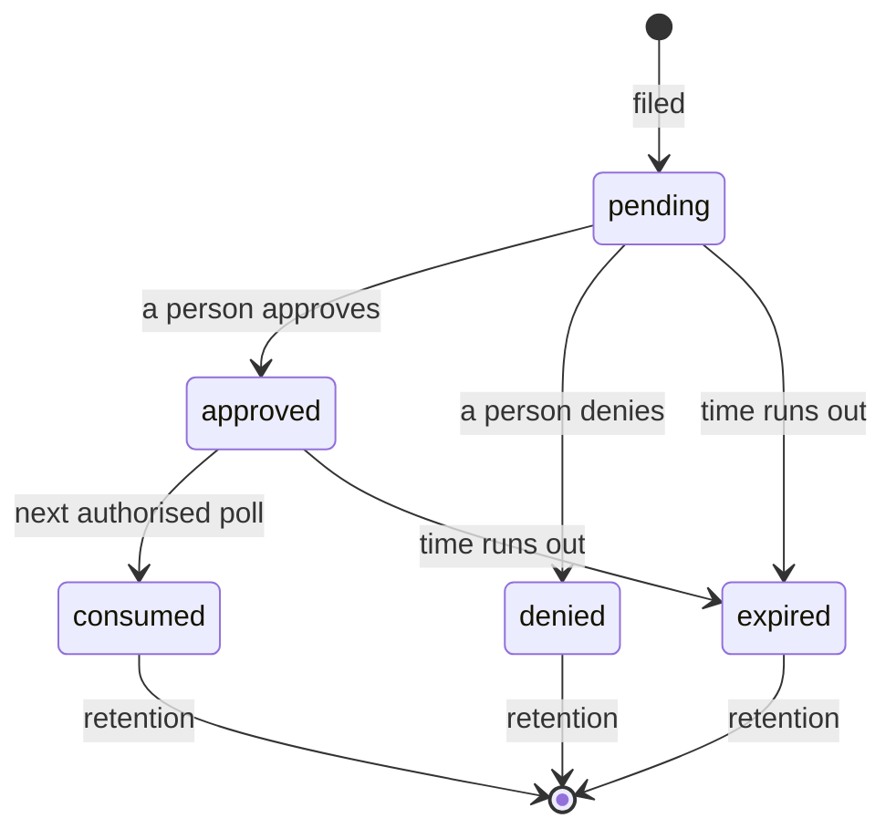
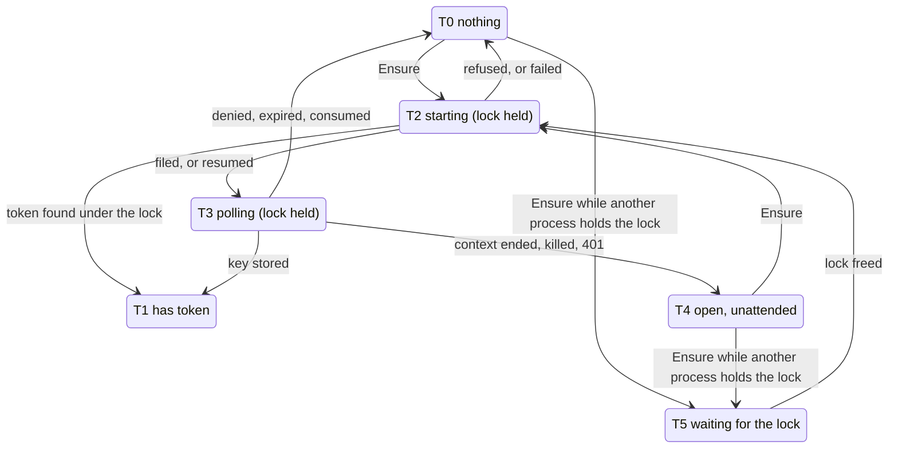
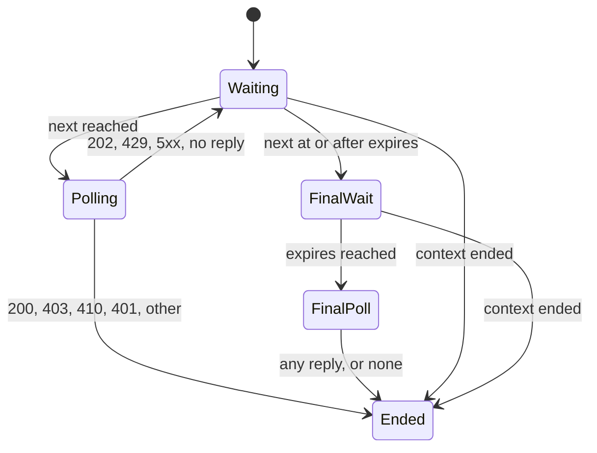
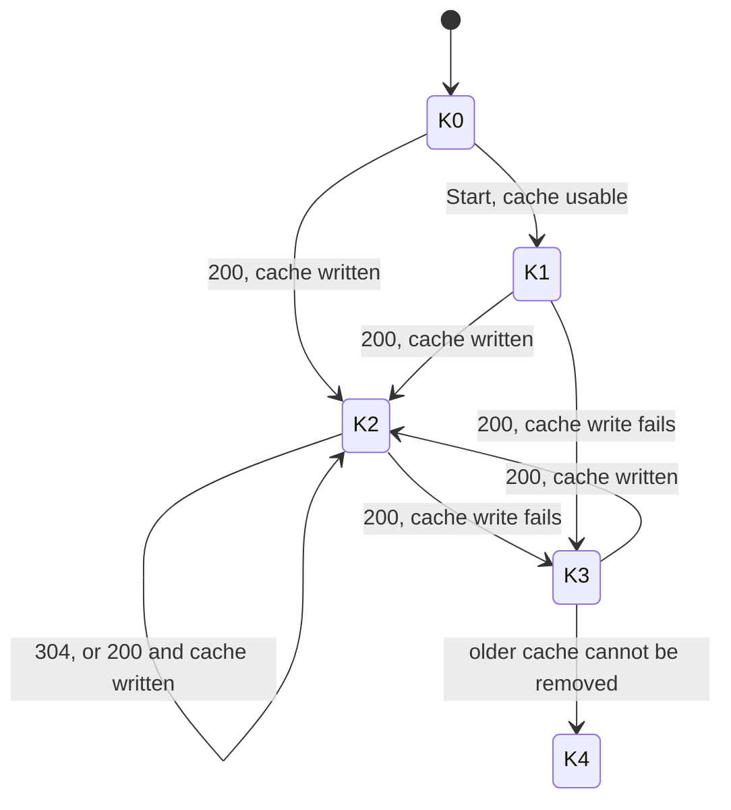
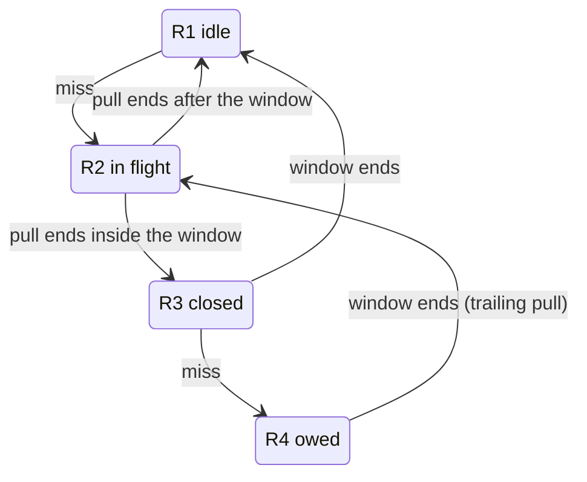

# States

Every state machine in the key flow, written out: the ones the code names and the ones it does not (a pair of
booleans, a file that exists or not, a held lock, a field that is set or unset). The contract is
[`CONTRACT.md`](CONTRACT.md); this file says what must be true between its messages.

How to read it:

- A **state** is defined by what can be observed: which files exist, which fields are set, who holds the lock.
- A **transition table** has one row per state and event, failures included. Rows are numbered so they can be
  cited (`T-16`, `K-6`).
- An **invariant** holds in every state of its machine.
- Every row and invariant is the behaviour of the reference packages (`request`, `keylist`, `keyclienttest`); the
  tests are named after the rows they prove (`TestT16_…`, `TestKI1_…`).

Terms are those of the contract: the **provider** issues keys, a **service** checks them, a **tool** needs one.

| # | Machine | Where it lives |
|---|---|---|
| 1 | A key request | the provider |
| 2 | One token file | the tool: token file, pending file, lock, calls in progress |
| 3 | One poll loop | the tool: `request` |
| 4 | The key list source | the service: `keylist` |
| 5 | Refresh on miss | the service: `keylist` |
| 6 | Start-up and shutdown | both halves |
| 7 | Where the machines meet | |

## 1. A key request at the provider

Variables of one request: its **state**; `expires_at`, set when it is filed; and its pacing: `last_poll` (unset, or
the time the last counted poll was handled) and `interval` (starts at the value the `201` gives).

| State | What is true |
|---|---|
| none | No request with this id: never filed, or removed after the retention time. |
| pending | Filed, not decided, `expires_at` not reached. It is on the approval page. No key exists. |
| approved | A person approved it: approver, name and role are recorded. `expires_at` not reached. No key exists yet. |
| consumed | The key was generated and its hash is in the service's list. Final. |
| denied | A person denied it. Final. |
| expired | `expires_at` passed while it was pending or approved. No key was ever made. Final. |

A poll is checked in this order: the poll secret, the expiry, a final state, the pacing, the delivery. A poll is
**on time** when `last_poll` is unset or at least `interval` seconds old, else **early**.

| # | State | Event | Next | Side effects and reply |
|---|---|---|---|---|
| P-1 | none | filing accepted | pending | `201` with id, poll secret (only its hash is kept), code, interval, `expires_in`. `last_poll` unset. |
| P-2 | none | filing refused: bad body, role not offered, a limit | none | `400`, `404`, `413`, `429` or `503`. Nothing stored. |
| P-3 | none | poll | none | `401`. |
| P-4 | any | poll with a wrong or missing secret | same | `401`. Nothing changes: not the state, not the pacing. |
| P-5 | pending | poll on time | pending | `last_poll = now`. `202` with `interval`. |
| P-6 | pending | poll early | pending | `last_poll = now`, `interval += 2` (up to a cap of ten times the first interval). `429` with the new interval. |
| P-7 | pending | a person approves | approved | Approver, name, role and time recorded. No key. `expires_at` becomes at least now plus two intervals, so the tool's next poll can still collect. |
| P-8 | pending | a person denies | denied | Who and when recorded. |
| P-9 | pending | `expires_at` reached | expired | Recorded at the next poll or by a sweep; every read treats it as expired from that moment. |
| P-10 | approved | poll on time | consumed | One transaction: generate the key, store its hash, revoke an earlier active key of the same service and name, mark consumed. `200` with the key, after the commit. |
| P-11 | approved | poll early | consumed | As P-10. Pacing limits polls of an undecided request; it must not hold back a delivery. |
| P-12 | approved | the delivery transaction fails | approved | `5xx`. Nothing changed, pacing included. The next poll delivers. |
| P-13 | approved | committed, reply lost | consumed | The key is in the list and nobody holds it. The next poll gets `410 consumed`. The next delivery for the same name replaces it. |
| P-14 | approved | a person approves or denies again | approved | Refused. Nothing changes. |
| P-15 | approved | `expires_at` reached | expired | No key was made; nothing to clean up. |
| P-16 | denied, expired, consumed | poll | same | `403`, `410 expired`, `410 consumed`. Not counted for pacing. |
| P-17 | denied, expired, consumed | a person approves or denies | same | Refused. Nothing changes. |
| P-18 | denied, expired, consumed | retention time passes | none | The request is removed. Keys are not. |
| P-19 | any | the provider restarts | same | State and pacing are durable. |

A consumed request cannot go back; a pending or approved one cannot be approved after `expires_at` (P-9 and P-15
come first).

Invariants:

- **P-I1** A key exists only for a consumed request, and exactly one for each.
- **P-I2** The state moves only along the arrows. A final state never changes.
- **P-I3** `interval` never goes down. Only a counted poll (P-5, P-6, P-10, P-11) changes the pacing.
- **P-I4** A `401` changes nothing.
- **P-I5** `expires_at` is set at filing and is not moved afterwards (except by the grace of P-7).
- **P-I6** Neither the poll secret nor the key is stored; only their hashes.
- **P-I7** An approved request is delivered by the first authorised poll that arrives before `expires_at`,
  whatever the pacing.

## 2. The tool side for one token file

Everything a tool keeps for one token path, across all its processes.

| Variable | Values |
|---|---|
| Token file **T** | *absent* (missing or empty) or *present*. |
| Pending file **P** (`token + ".pending"`) | *absent*; *current* (a regular file of mode 0600 whose values pass the rules, filed for this run's service URL and override, not expired); *foreign* (valid, but for another service URL or override); *expired*; *unusable* (wrong type or mode, not owned by the effective user, or values that break the rules). |
| Lock **L** (`flock` on `token + ".lock"`) | *free*, *mine* (this process holds it) or *other's*. The lock file itself stays on disk once made. |
| Flow entry **F** (in memory, one per token path per process) | *none*; *starting* (no notice yet); *noticed* (a notice exists). |

| State | What is true |
|---|---|
| T0 Nothing | T absent, P absent, L free, F none. |
| T1 Has token | T present. P should be absent; one left by a crash is ignored. |
| T2 Starting | L mine, F starting, T absent. The flow is reading P, discovering, or filing. |
| T3 Polling | L mine, F noticed, P current, T absent. The poll loop (machine 3) runs, in the caller's goroutine (`Wait` true) or in a background goroutine after `Ensure` returned `*ErrPending` (`Wait` false). |
| T4 Open, unattended | T absent, P current, L free, F none. A request is open at the provider and nobody polls it. |
| T5 Waiting for the lock | L other's. This process has a flow entry and waits. |
| T6 Stale file | T absent, L free, P foreign, expired or unusable. |

The **owner** of a flow is the first caller for a token path in a process; later callers in that process **join**
it.

| # | State | Event | Next | Side effects |
|---|---|---|---|---|
| T-1 | T1 | `Ensure` | T1 | Returns the token. No lock, no network, no file touched. |
| T-2 | T absent | `Ensure` with neither a service URL nor an override | same | `ErrNoProvider`. Nothing touched. |
| T-3 | T absent | `Ensure` with a URL the transport rule refuses | same | Error. Nothing sent, nothing touched. |
| T-4 | T0, T4, T6 | `Ensure`, lock free | T2 | Flow entry made. When there is no override and no P on disk, discovery runs first (T-7), before anything is created. Lock file created (0600; its directory 0700) if missing, never through a link. Lock taken. Temporary files of this token and of P are removed (T-25). |
| T-5 | T absent | `Ensure` where the lock is not supported | same | An error that wraps `errors.ErrUnsupported`. Nothing filed. |
| T-6 | T2 | T is present once the lock is held | T1 | Returns that token: another holder stored it. A P left beside it is removed (T-27). |
| T-7 | T2, P absent | discovery answers `404` | T0 | `ErrNoProvider`. Discovery runs before the lock is made, so a service without a provider leaves nothing on disk. |
| T-8 | T2, P absent | discovery fails; filing is refused; the `201` breaks a rule | T0 | Error. Nothing shown, nothing stored. A `201` that was refused leaves an open request at the provider that nobody polls; it expires there. |
| T-9 | T2, P absent | `201` accepted, P cannot be written | T0 | Error. The same orphan as T-8. |
| T-10 | T2, P absent | `201` accepted, P written | T3 | `Notify` once. P records the request, the service URL, the override, the current interval and when the next poll is due. |
| T-11 | T2, P current | | T3 | Resumed: no discovery, no filing. `Notify` once, marked resumed (with `Wait` false, after the due poll of T-16, and not at all if that poll settles the request). |
| T-12 | T2, P expired or foreign | | T2 | P removed; continue as P absent (with the request URL found by an early discovery, if one ran). A foreign P leaves an orphan at its provider. |
| T-13 | T2, P unusable | | T6 | Error that names the file. Nothing filed, nothing removed. |
| T-14 | T2, T3, T5 | `Notify` panics | T4 | The panic reaches the owner's caller. The flow ends with an error for every joined caller. Lock released. P kept. |
| T-15 | T3, `Wait` true | the poll loop ends | by L-rows | The loop's result is returned. Then the lock is released and the flow entry removed. |
| T-16 | T3, `Wait` false | | T3 | `Ensure` returns `*ErrPending` with the notice. The loop goes on in the background **and keeps the lock** until it ends. If the request was resumed and a poll is already due, that one poll is made before returning, and before `Notify`: if that poll settles the request, its result is returned (T1 or T0) and no notice is shown; if the request is still undecided (`202`, `429`, `5xx`, no reply), `Notify` is called once and `*ErrPending` returned; if the poll stops the loop with the request kept (L-12, L-16, L-18), that error is returned and no notice is shown, since approving would not help while polls are refused. So a tool that prints the notice and exits collects the key on a later run without printing "approve at" first. A request just filed is never polled before returning. |
| T-17 | T3 | another goroutine calls `Ensure`, `Wait` false | T3 | It gets the same `*ErrPending`, or the flow's result if the flow has already ended. No second notice, filing or poller. |
| T-18 | T2 | another goroutine calls `Ensure`, `Wait` false | T2 | It waits until the notice exists or the flow ends, or its own context ends. If the owner is waiting for another process's lock with no notice to show (T5), it gets `ErrBusy` at once. |
| T-19 | T2, T3 | another goroutine calls `Ensure`, `Wait` true | same | It waits for the flow's end and gets its result. If the flow ended for a reason that is not this caller's own (its owner's context ended while this caller's has not, or a T-22 background flow ended with `ErrBusy`), it starts over as owner (T-4). |
| T-20 | T2, T3 | a joined caller's context ends | same | That caller gets its context's error. The flow is not affected. |
| T-21 | T2, T3 in another process | `Ensure`, `Wait` true | T5 | Waits for the lock, up to its context. Shows the notice read from P once, marked resumed, so the wait is not silent. When the lock is free: T-6 or T-11, without a second notice for the same request. |
| T-22 | T2, T3 in another process | `Ensure`, `Wait` false | T5 | P current: `Notify` once (resumed) and return at once an `*ErrPending` built from P; a background goroutine waits for the lock and then follows T-6, or T-11 for that same request only, or ends with `ErrBusy` if P no longer holds that request (a different current request is not resumed). P absent, foreign, expired or unusable: `ErrBusy` at once; nothing filed or shown. |
| T-23 | T5 | this caller's context ends | as before | Error that wraps the context's. Nothing touched. |
| T-24 | T3 | the owner's context ends | T4 | P kept. Lock released. The flow ends with the context's error; an `*ErrPending` reports it through `Err`. |
| T-25 | T2, T3 | the process is killed | T4, or T0 | The kernel frees the lock. Files stay as they were: each write is whole or absent. Killed after the `201` and before P was written: T0 and an orphan. A temporary file may remain; the next lock holder removes those of this token. |
| T-26 | T3 | something else writes T | T3 | Nothing yet. At approval or at `410 consumed` the existing token is kept and returned; P is removed (L-9, L-14). |
| T-27 | T1 with P present | `Ensure` | T1 | As T-1. P is a leftover of a crash between storing the key and removing P; the next lock holder removes it. |
| T-28 | T absent | the lock path is a link, not a regular file, not owned by the effective user, writable by group or others, cannot be opened, or the file system has no locks | same | Error that names the lock file. Nothing filed: a file system without locks fails closed. |
| T-29 | T2, T3 | `Ensure` in the same process through another name for the same token file | T5 for it | A second flow entry, which waits on the lock like another process. |
| T-30 | any | `Pending` (a status read, for example a tool's `key status` command) | same | Reads P without the lock and changes nothing, with every check of T-11 and T-13: no P gives nothing; P current gives its notice, marked resumed; P expired, foreign or unusable gives an error that tells which (`ErrPendingExpired`, `ErrPendingForeign`, `ErrPendingUnusable`, the last naming the file). It does not look at T, takes no lock, sends nothing, and never returns the poll secret. A holder of the lock does not block it. |

Invariants:

- **T-I1** Whoever polls a request holds the lock, from before it reads P until its poll loop has ended. So at
  most one process, and one goroutine in it, polls a given request or files for a given token.
- **T-I2** P is created, replaced and removed, and T is written, only by the lock holder. (T-1 reads T without it; T-4's existence check of P before an early discovery, T-21, T-22 and T-30 read P without it, and only read.)
- **T-I3** A request is filed only when, under the lock, T is absent and P is absent.
- **T-I4** T is written only from an approved reply to the request in P, only while T is absent, atomically, with
  mode 0600.
- **T-I5** `Ensure` returns a token with a nil error, or a non-nil error (`*ErrPending` included). Never an empty
  token with a nil error; `Ready` is true only when the token is on disk.
- **T-I6** With T present, `Ensure` sends nothing and writes nothing.
- **T-I7** The poll secret is in P only and the key in T only, both 0600; neither is in an error, a notice or a log.
- **T-I8** Nothing from the provider is shown or stored before it has passed the contract's rules.
- **T-I9** A call with `Wait` false never waits for a person or for another process: only network time
  limits bound it.
- **T-I10** Progress: while a request is approved and not expired, a tool that calls `Ensure` again after the next
  poll is due collects the key, whatever its `Wait` and however short each run is.

## 3. One poll loop

One loop polls one request. It runs only in T3. Variables: the current interval `I`, the time `next` of the next
poll, the expiry `expires` (the arrival of the `201` plus `expires_in`, at most 24 hours; a resumed run also caps it at 24 hours from its start).

| State | What is true |
|---|---|
| Waiting | Sleeping until `next`. No request in flight. |
| Polling | One `POST` to the poll URL is in flight, with the poll secret. |
| Final wait | `next` would fall at or after `expires`: sleeping until `expires` for one last poll. |
| Final poll | The last poll is in flight. |
| Ended | One of: stored, kept an existing token, denied, expired, consumed, stopped with P kept, cancelled. |

| # | State | Event | Next | Side effects |
|---|---|---|---|---|
| L-1 | start, after a `201` | | Waiting | `next` = arrival of the `201` + `I`. |
| L-2 | start, resumed | | Waiting | `I` and `next` are those P recorded; a `next` in the past, or missing, means now; a `next` more than `I` away (a clock set back) means now + `I`, and that corrected time is written back to P, so the next short run does not cut it again. |
| L-3 | Waiting | `next` reached | Polling | |
| L-4 | Waiting | `next` at or after `expires` | Final wait | |
| L-5 | Waiting, Final wait | the context ends | Ended: cancelled | P kept. |
| L-6 | Polling | `202` | Waiting | `I` = the reply's interval if it is readable and at least 1. `next` = arrival + `I`. |
| L-7 | Polling | `429` | Waiting | `I` = the reply's interval if it is readable and at least `I` (at the provider's cap it is unchanged), else `I + 2`. `next` = arrival + `I`. |
| L-8 | Polling | `200` approved, key within its rule, T absent | Ended: stored | T written atomically, 0600. P removed. Returns key, name, role. |
| L-9 | Polling | `200` approved, T present | Ended: kept | The existing token is returned. The received key is dropped. P removed. |
| L-10 | Polling | `200` approved, key breaks its rule | Ended: error | Nothing stored. P removed: the request is spent. |
| L-11 | Polling | `200` approved, T cannot be written | Ended: error | P removed. The key is lost; the next use files again. |
| L-12 | Polling | `200` that is unreadable, too large or not approved | Ended: error | P kept. A later poll tells what happened. |
| L-13 | Polling | `403` | Ended: denied | P removed. |
| L-14 | Polling | `410 consumed` | Ended | P removed. T present: its token is returned. T absent: `ErrConsumed`. |
| L-15 | Polling | any other `410` | Ended: expired | P removed. |
| L-16 | Polling | `401` | Ended: stopped | `ErrUnauthorized`, with the provider's message made safe. P kept. |
| L-17 | Polling | `5xx`, network error, no reply in time | Waiting | `I` unchanged. `next` = time of the failure + `I`. |
| L-18 | Polling | any other status, `3xx` included | Ended: stopped | Error that names the status. P kept. No redirect is followed. |
| L-19 | Polling | the context ends | Ended: cancelled | P kept. A reply that did arrive in full is handled first: a delivered key is stored, not dropped. |
| L-20 | Final poll | `202`, `429`, `5xx`, no reply | Ended: expired | P removed. |
| L-21 | Final poll | any reply of L-8 to L-16, L-18 | as that row | |
| L-22 | Polling, any | after each poll that keeps the loop going (L-6, L-7, L-17) | same | P is rewritten with `I` and `next`, if it still holds this request, so a later run keeps the pace. A failed rewrite is ignored; the pace holds in memory. |
| L-23 | any | the process is killed | none | P as it was (T4); or T present, perhaps with P left (T-27). |

Invariants:

- **L-I1** Two polls of one request are at least the current interval apart, counted from the arrival of the
  earlier reply. The one final poll at `expires` is the only exception. This holds across runs too.
- **L-I2** The loop ends no later than `expires` plus one request time limit.
- **L-I3** T is written at most once, and never with a key that breaks the key rule.
- **L-I4** Every end leaves P as its row says: removed when the request is settled, kept when it may still be
  collected.

## 4. The key list source

One `Source` in a service. Variables:

| Variable | Values |
|---|---|
| Memory list **M** | *empty*; *from cache*; *from provider* (the accepted entries of the latest good `200`). |
| Version marker **E** (the `ETag`) | *unset* or *set*. Sent as `If-None-Match` when set. |
| Cache file **C** | *absent*; *current* (the body M came from); *older* (an earlier body); *unusable* (not a regular file, not owned by the effective user, writable by group or others, or not a valid list). |
| Refresher | *not started*, *running*, *stopped* (the context given to `Start` ended). |

| State | What is true |
|---|---|
| K0 New | M empty, E unset, refresher not started. C is whatever an earlier run left. |
| K1 From cache | M is what C held at `Start`, E unset. No good pull yet in this process. |
| K2 Fresh | M from provider, E set to the `ETag` of that reply, C current. |
| K3 Fresh, not cached | M from provider, E unset, C absent or emptied. Health says the cache is failing. |
| K4 Fresh, older cache left | As K3, but the older C could be neither removed nor emptied. Logged as an error and in health. |

A failed pull is not a state of its own: it leaves M, E and C alone and shows in health.

| # | State | Event | Next | Side effects |
|---|---|---|---|---|
| K-1 | K0 | `Start`, C usable | K1 | M swapped to C's accepted entries. Then one pull at once, without `If-None-Match`. |
| K-2 | K0 | `Start`, C absent or unusable | K0, running | M empty. Logged. Opening C never blocks. One pull at once. |
| K-3 | K2, K3, K4 | `Start` (a pull landed before it) | same | C is not loaded: M is newer. |
| K-4 | any | `Start` a second time | same | Error. |
| K-5 | any | pull: good `200`, C written | K2 | C is written first, then M is swapped, so a crash between the two never leaves C older than a list that was live. E = the reply's `ETag` (unset if it has none). |
| K-6 | any | pull: good `200`, C cannot be written; the older C is removed, or emptied without following a link and only if it is a regular file | K3 | M swapped. **E unset**, so the next pull is a full `200` and the write is tried again. `Pull` returns an error that wraps `ErrCacheWrite`; health says so. Logged once at the start of a streak of failing writes, and once when a write succeeds again, as K-10 does for pulls. |
| K-7 | any | as K-6, and the older C can be neither removed nor emptied | K4 | As K-6, and logged as an error on its first occurrence in a streak of failing writes: a restart while the provider is down would load the older list. |
| K-8 | K2 | pull: `304` | K2 | Nothing changes. A success. |
| K-9 | E unset | pull: `304` | same | A failure: nothing was asked conditionally. |
| K-10 | any | pull fails: bad body, wrong media type, too large, `401`, `404`, `3xx`, `5xx`, network error, time limit, pull token unreadable | same | M, E and C unchanged. The first failure of a streak is logged, and the recovery. Health holds the error. |
| K-11 | running | the refresh time comes | by K-5 to K-10 | One pull. Pulls never overlap. |
| K-12 | running | the context ends | stopped | No more pulls. M stays and lookups go on. A pull cut short by this is not a failure: not logged as one, and health (`LastError`, the failure streak) is left as it was. An explicit `Pull` by the service after this still runs. |
| K-13 | any | the process is killed during a cache write | K0 at restart | C is the old body or the new one, never part of one. A temporary file may remain; `Start` removes those of this cache, whether or not it then loads C. |
| K-14 | any | restart | K0 | E is not kept: the first pull is a full one. |
| K-15 | any | a lookup | same | Reads M only: one whole list, the old or the new. |
| K-16 | any | the service's own tokens or roles change, so `Accept` would now decide otherwise | same | Not supported while running: `Accept` must give the same answer for the same entry for the life of a `Source`. A restart applies the change: E starts unset (K-14), so the cache and the first pull are filtered afresh. |

Invariants:

- **K-I1** E is set only if M is the list that came with E and C holds that same body.
- **K-I2** C never holds a list older than one that has been live in M. K4 is the one exception, and it is reported.
- **K-I3** A failed pull changes none of M, E and C.
- **K-I4** M changes only by a whole swap: on a good `200`, or at `Start` from C when no `200` has been applied.
- **K-I5** M holds no entry that `Accept` refused when it was swapped in, and no name or hash twice.
- **K-I6** At most one pull is in flight.
- **K-I7** Health tells where M came from (nothing, the cache, the provider) and how old it is: the time
  since the last good pull (a `304` included), or for a cache the age of the cache file. A list served from an old
  cache is never reported as age zero. (`Status.Origin`, `Status.ListTime`, `Status.Age`.)

## 5. Refresh on miss

A **miss** is a non-empty presented key that is not in M. Variables: the miss-triggered pull in flight (none or
one), the **window** (closed for `refresh_on_miss` after such a pull starts, else open), whether a trailing pull
is **owed**, and the number of **waiters** (0 to 100).

| State | What is true |
|---|---|
| R0 Off | `refresh_on_miss` is 0. |
| R1 Idle | No miss pull in flight. Window open. Nothing owed. |
| R2 In flight | A miss pull is running. Up to 100 callers wait for it. |
| R3 Closed | No miss pull in flight. Window closed. Nothing owed. |
| R4 Owed | No miss pull in flight. Window closed. A trailing pull is due when the window ends. |
| R5 Stopped | The context given to `Start` has ended. |

| # | State | Event | Next | Side effects |
|---|---|---|---|---|
| R-1 | R0 | miss | R0 | Refused at once. |
| R-2 | R1 | miss | R2 | One pull starts (conditional when E is set) and the window closes. The caller waits. |
| R-3 | R2 | miss, fewer than 100 waiting | R2 | The caller waits for the same pull. |
| R-4 | R2 | miss, 100 waiting | R2 | Answered at once from M. If the window is still closed, a trailing pull is owed; if it is already over, nothing is armed (the next miss after this pull starts its own). |
| R-5 | R2 | the pull ends, window still closed | R3, or R4 if owed | Waiters wake and look the key up again. |
| R-6 | R2 | the pull ends, window already over | R1 | As R-5. Anything owed is dropped. |
| R-7 | R3 | miss | R4 | Answered at once, after one more lookup. No pull. The trailing pull is armed for the window's end. |
| R-8 | R4 | miss | R4 | Answered at once. No pull, no second timer. |
| R-9 | R3 | the window ends | R1 | |
| R-10 | R4 | the window ends | R2 | The trailing pull starts, with no waiters. It is the new window's one pull. |
| R-11 | R2 | a waiter has waited 2 s | R2 | That caller is answered from M. The pull goes on. |
| R-12 | R2 | a waiter's own context ends | R2 | As R-11. The pull is never cancelled by a caller. |
| R-13 | any | a key that is in M | same | Accepted. Nothing else happens. |
| R-14 | any | an empty key | same | Refused. Never a miss. |
| R-15 | R1 to R4 | the context given to `Start` ends | R5 | Anything owed is cancelled. A pull in flight is cut short (K-12). |
| R-16 | R5 | miss | R5 | Answered at once from M, even while a pull cut short by the shutdown is still in flight. No pull is started and nothing is logged. |
| R-17 | before `Start` | miss | as R-1 to R-10 | The pull is not tied to any context. |
| R-18 | any | the timed refresh runs | same | Pulls are serialised: a miss pull may wait behind the timed one. The timed schedule never moves. |

Invariants:

- **R-I1** At most one miss-triggered pull runs, and at most one starts per window. A trailing pull is the next
  window's one.
- **R-I2** No miss waits longer than 2 s, and at most 100 wait at once. The count of waiters returns to zero.
- **R-I3** A caller's context never cancels a pull.
- **R-I4** The miss path never changes when the timed refresh runs.
- **R-I5** A key in M is answered without waiting, whatever the provider does.
- **R-I6** No pull starts after the context given to `Start` has ended.

## 6. Start-up and shutdown

| Situation | Tool | Service |
|---|---|---|
| First run, nothing on disk | T0. `Ensure` runs discovery, then makes the directory (0700) and the lock file, files, writes P, and on approval T (T-4 to T-10, L-8). | K0. `Start` finds no cache: M empty, one pull at once. The first good `200` makes the cache directory (0700) and C (K-2, K-5). |
| Provider unreachable at start | T0: discovery fails, an error, nothing written (T-7, T-8); or filing fails after discovery, an error, nothing written but the lock file (T-8). T4: the request is resumed and each poll fails as L-17 until `expires`. | K1 if C is usable, else M empty. The service starts either way. One failure is logged; a later tick recovers (K-10). |
| Restart after a clean stop | T1, T0 or T4, as left. | K0 then K1: C is current. |
| Restart after a crash | The lock is free. P is current, expired, or absent (T-25). T and P may both be there (T-27). A temporary file may remain. | C is the old or the new body (K-13). A temporary file may remain. E starts unset (K-14). |
| A file left by an older or broken run | P unusable: an error that names it (T-13). P foreign or expired: removed (T-12). | C unusable: ignored and logged (K-2). |
| Shutdown | The context ends: P kept, lock released (T-24, L-5, L-19). | The context ends: refresher and trailing pull stop, M stays (K-12, R-15). |

## 7. Where the machines meet

**The tool's poll loop and the provider's pacing (machines 3 and 1).**

| Case | What happens | Rule that covers it |
|---|---|---|
| One poller, keeping L-I1 | Each poll reaches the provider at least `interval` after the one before. It is never told to slow down. | L-I1 |
| Two pollers on one request | Cannot happen within the rules: the lock is held by whoever polls. If it did, each poll would fall inside the other's interval and get `429`, and the interval would grow by 2 each time up to its cap; an approved request is still delivered by the first authorised poll. | T-I1 forbids it. P-11 makes it harmless. |
| A resumed run | It polls on the interval and at the time P recorded, so the provider sees the same pace as from one long run. | L-2, L-22, L-I1 |
| A run that ends before its first poll is due | A `Wait` false call makes the one poll that is due before it returns, so repeated short runs each poll once when due and collect the key after approval. | T-16, T-I10 |
| The final poll at `expires` | It is early by the provider's pacing, and the provider's `expires_at` has passed by then: `410 expired`. | L-20 |
| Approval in the last interval before `expires_at` | Approval moves `expires_at` to at least the time of approval plus two intervals, so the tool's next poll, early or not, still collects the key. | P-7 with P-11 |
| The reply that carries the key is lost | Provider: consumed. Tool: `410 consumed` at the next poll, then a new request at the next use, whose delivery replaces the unused key. | P-13, L-14 |
| The provider restarts during a flow | The tool sees L-17 until it is back; the request is as it was. | P-19 |

**A new key and the service's list (machines 1, 4 and 5).** The key's hash is in the list from the commit of
P-10, before the tool has the key. The tool's first call with it is a miss: R-2 pulls and the key is found. If the
window is closed (R-7) the call is refused and the trailing pull (R-10) brings the key in; the tool retries once
after `refresh_on_miss`.

**Revocation and the cache (machines 1 and 4).** A revoked or replaced key leaves the list at once. A service
drops it at its next good `200`: within `refresh`, or sooner by a miss pull. K-I1 and K-I2 are what keep it from
coming back: a `304` can only confirm a list that is both live and cached, and a restart can only load a list at
least as new as the last one that was live.

**Miss pull and timed pull (machines 5 and 4).** They share one pull at a time (K-I6). A miss pull that queues
behind a timed pull can take two pull time limits; waiters still leave after 2 s (R-11).
